<div align="center">

</div>

<div align="center">

<br>

<p align="center">
<a href="https://www.iana.org/assignments/registrar-ids/registrar-ids.xhtml"></a>
<a href="https://www.cisa.gov/tlp"></a>
</p>

<p align="center">
<a href="LICENSE"></a>
<a href="https://phishdestroy.github.io/nicenic-evidence/"></a>
</p>

<br/>

# NICENIC Zone Scan — Complete Registrar Investigation

**Phase I · NICENIC INTERNATIONAL GROUP CO., LIMITED · IANA #3765**

*Complete-zone scan of a Chinese registrar enabling industrial-scale domain abuse*

</div>

<p align="center"></p>
<details>
<summary>&nbsp; <strong>⚖️ ICANN Compliance Complaints</strong></summary>

## ⚖️ ICANN Compliance Complaints

> Formal abuse complaints submitted to ICANN Contractual Compliance (RAA §3.18 · DNS Abuse Advisory 2024).

| Date | Target | IANA ID | Reported Domains | DNS-active in complaint snapshot | Days Ignored |
|---|---|---|---|---|---|
| [2026-08-05](complaints/2026-08-05-nicenic-icann/) | NiceNIC International Group Co., Limited | 3765 | 13,104 | 4,430 | 158 median / 215 max |

📁 Full evidence: [`complaints/`](complaints/)

<sub>Complaint figures above are preserved from the published evidence package; they are not live status counters. Current domain monitoring is shown separately below.</sub>

</details>

<!-- LIVE_STATS:START -->

> 🔴 **LIVE INVESTIGATION FEED** &middot; Auto-updated &middot; Last fetch `2026-10-31`

<table align="center"><tr>
<td align="center"><b>📦 Domains tracked</b><br/><strong>424,662</strong></td>
<td align="center"><b>💰 Est. annual value</b><br/><strong>$3,087,171</strong></td>
</tr><tr>
<td align="center"><b>📡 Deployed</b><br/><strong>33.9%</strong></td>
<td align="center"><b>✅ IOC classified</b><br/><strong>71,028</strong> (65,600 HIGH)</td>
</tr><tr>
<td align="center"><b>⚡ Registered ≤7d</b><br/><strong>0.8%</strong></td>
<td align="center"><b>🕵️ Serial regs</b><br/><strong>31</strong></td>
</tr></table>

<details>
<summary><strong>Live analytics · TLDs, hosting, registrations and downloads</strong></summary>

### 🏷️ Top TLD Zones

| TLD | Count | Avg reg→expiry | Est. annual value |
|:--|--:|--:|--:|
| `.com` | 206,985 | 616d | $1,860,795 |
| `.icu` | 41,413 | 377d | $40,999 |
| `.vip` | 30,742 | 375d | $153,403 |
| `.xyz` | 17,859 | 434d | $26,610 |
| `.net` | 16,457 | 730d | $164,405 |
| `.info` | 14,491 | 492d | $57,819 |
| `.live` | 13,900 | 419d | $138,861 |
| `.sbs` | 11,669 | 403d | $58,228 |
| `.cfd` | 10,500 | 442d | $52,395 |
| `.pro` | 8,896 | 401d | $71,079 |

### 🌍 Top Hosting Countries

```
US  ██████████████████      6,180 (28.4%)
NL  ████████░░░░░░░░░░      3,010 (13.8%)
DE  ██████░░░░░░░░░░░░      2,329 (10.7%)
TR  ███░░░░░░░░░░░░░░░      1,185 (5.4%)
CN  ███░░░░░░░░░░░░░░░      1,068 (4.9%)
SE  ██░░░░░░░░░░░░░░░░      1,010 (4.6%)
RU  ██░░░░░░░░░░░░░░░░        924 (4.2%)
HK  ██░░░░░░░░░░░░░░░░        785 (3.6%)
```

### 📈 Registration Burst Days

| Date | Domains | × Average |
|:--|--:|--:|
| `2026-10-07` | 1,839 | **23.6×** 🚨 |
| `2026-09-16` | 1,809 | **23.2×** 🚨 |
| `2026-10-12` | 1,738 | **22.3×** 🚨 |
| `2026-10-08` | 1,586 | **20.3×** 🚨 |
| `2026-09-17` | 1,565 | **20.1×** 🚨 |

### 🎯 Top Targeted Brands & Keywords

`coinbase (2,599)` &middot; `claim (2,458)` &middot; `login (2,145)` &middot; `official (1,806)` &middot; `wallet (1,681)` &middot; `secure (1,521)` &middot; `swap (1,411)` &middot; `ledger (1,358)` &middot; `token (1,340)` &middot; `support (1,255)` &middot; `crypto (1,242)` &middot; `trust (1,148)` &middot; `update (1,139)` &middot; `connect (1,138)` &middot; `kraken (1,109)`

### 🕵️ Top Serial Registrants — 50 emails with ≥5 domains

| # | Registrant Email (redacted) | Domains |
|--:|:--|--:|
| 1 | `don***@opencart.com` | **42** |
| 2 | `sup***@anonymixer.com` | **39** |
| 3 | `con***@rocketx.exchange` | **37** |
| 4 | `des***@slotvadi.com` | **28** |
| 5 | `aff***@slotvadi.com` | **28** |
| 6 | `inf***@slotvadi.com` | **28** |
| 7 | `inf***@wbahis.com` | **24** |
| 8 | `com***@wbahis.com` | **24** |
| 9 | `sup***@winshark.com` | **22** |
| 10 | `dei***@email.de` | **21** |

### 📥 Download Threat Intelligence

| File | Format | Description |
|:--|:--:|:--|
| [`data/all.txt`](data/all.txt) | TXT | All tracked domains |
| [`data/index.json`](data/index.json) | JSON | Full analytics snapshot |
| [`data/ioc/serial_registrants.json`](data/ioc/serial_registrants.json) | JSON | Repeat registrants + their domains |
| [`data/ioc/shared_ips.json`](data/ioc/shared_ips.json) | JSON | Shared hosting clusters |
| [`data/ioc/brand_domains.json`](data/ioc/brand_domains.json) | JSON | Domains by targeted brand |
| [`data/ioc/stix-bundle.json`](data/ioc/stix-bundle.json) | STIX 2.1 | MISP/OpenCTI bundle (HIGH IOC domains, up to 10k) |
| [`data/ioc/serial_emails.txt`](data/ioc/serial_emails.txt) | TXT | grep-friendly: `email⇥count` |
| [`data/ioc/shared_ips.txt`](data/ioc/shared_ips.txt) | TXT | grep-friendly: `ip⇥count⇥country` |

> 📊 Live web dashboard: see Pages link at top · Updated daily 02:00 UTC

</details>

<!-- LIVE_STATS:END -->

<p align="center"></p>


<p align="center"><sub><b>NICENIC / INVESTIGATION INDEX</b></sub></p>

<p align="center">
<a href="#user-content-background"></a>
<a href="#user-content-headline-findings"></a>
<a href="https://phishdestroy.github.io/nicenic-evidence/#analytics"></a>
</p>

<details>
<summary><strong>Full table of contents</strong> · 12 sections</summary>

**Investigation**
- [Background](#user-content-background)
- [Subject](#user-content-subject)
- [Scope](#user-content-scope)
- [Methodology](#user-content-methodology)

**Evidence**
- [Headline Findings](#user-content-headline-findings)
- [Operator Clusters](#user-content-operator-clusters)
- [Evidence Archive](#user-content-evidence-archive)
- [IOC Feed](#user-content-ioc-feed)

**Legal / Reuse**
- [Legal Notice](#user-content-️-legal-notice--responsible-disclosure)
- [Enforcement Posture](#user-content-enforcement-posture)
- [Repository Structure](#user-content-repository-structure)
- [Related Investigations](#user-content-related-investigations)

</details>

<p align="center"></p>

<details>
<summary>&nbsp; <strong>Background</strong></summary>

## Background

NICENIC INTERNATIONAL GROUP CO., LIMITED (IANA registrar #3765) is a Chinese domain registrar with a long-documented track record of slow abuse response, permissive registration policies, and infrastructure that is systematically exploited by phishing operators, carding shops, crypto drainers, illegal gambling networks, and malware distributors.

While NICENIC holds significantly more domains than the average registrar under investigation, the scale is itself the signal: fast, cheap, anonymous registration at volume is the product. The registrar's zone composition reflects a portfolio optimised for abuse enablement rather than legitimate hosting.

This investigation enumerates every domain in NICENIC's zone, classifies content using AI-assisted analysis and threat-intelligence cross-referencing, and publishes structured evidence for enforcement, blocklist, and SIEM use.

**Pipeline:**

```
[NICENIC Zone File — 403,909 domains]
         │
         ▼
┌─────────────────┐   aiohttp, 600 concurrent, Googlebot UA
│ Phase 1 — HTTP  │   Output: lambda_results.jsonl
│ Fingerprint     │
└─────────────────┘
         │
         ▼
┌─────────────────┐   Playwright + stealth v2, isolated context/domain
│ Phase 2 — Render│   SOCKS5 pool + 2captcha (hCaptcha/Turnstile/reCAPTCHA)
│ + Screenshots   │   Output: deep_results.jsonl, screenshots/*.jpg
└─────────────────┘
         │
         ▼
┌─────────────────┐   Llama 3.1 (Groq) for content classification
│ Phase 3 — AI    │   Rule-based pre-filter + Groq for ambiguous cases
│ Classification  │   Output: enriched.csv categories + descriptions
└─────────────────┘
         │
         ▼
┌─────────────────┐   ipinfo.io (country + ASN per IP)
│ Phase 4 — GeoIP │   Output: ip_country, ip_asn fields
└─────────────────┘
         │
         ▼
┌─────────────────┐   Redaction: scan-server IP, API keys, local paths
│ Phase 5 — PII   │   Output: clean enriched.csv, data.json, IOC feeds
│ Redaction       │
└─────────────────┘
```


</details>

<details>
<summary>&nbsp; <strong>Subject</strong></summary>

## Subject

| Field | Value |
|---|---|
| **Registrar name** | NICENIC INTERNATIONAL GROUP CO., LIMITED |
| **IANA ID** | #3765 |
| **Jurisdiction** | China |
| **WHOIS server** | `whois.nicenic.net` |
| **Abuse contact** | abuse@nicenic.net |
| **Zone size** | 403,909 domains (scan date: June 2026) |
| **Supported TLDs** | Generic TLDs (gTLD) — `.com`, `.net`, `.org`, `.xyz`, `.top`, `.shop`, `.app`, `.academy`, and 100+ more |
| **ICANN accreditation** | Active |


</details>

<p align="center"></p>

<details>
<summary>&nbsp; <strong>Scope</strong></summary>

## Scope

This investigation covers the **complete zone** of all domains registered under NICENIC (IANA #3765) as enumerated from public zone data in June 2026. Every domain — alive or dead — is included.

> **Note:** Screenshots and deep-render data were collected only for HIGH and MEDIUM severity domains (estimated 10–25% of zone) to constrain storage and runtime. Dead domains are enumerated and classified but not rendered.


</details>

<details>
<summary>&nbsp; <strong>Methodology</strong></summary>

## Methodology

<details>
<summary><strong>Phase 1 — HTTP Fingerprinting</strong></summary>

- **Tool:** Python 3.14 + `aiohttp`, 600 concurrent connections
- **User-Agent:** Googlebot 2.1 (bypass naive bot-blocks)
- **Timeout:** 5s connect, 8s read
- **Extracted:** HTTP status, final URL, server headers, title, H1, meta description, form fields, body snippet (first 64 KB)
- **Cloudflare detection:** `cf-ray` / `__cf_bm` presence in headers + body
- **Captcha detection:** hCaptcha / reCAPTCHA / Turnstile keyword matching
- **Output:** `data/lambda_results.jsonl` — one JSON object per domain

</details>

<details>
<summary><strong>Phase 2 — Browser Render & Screenshots</strong></summary>

- **Engine:** Playwright 1.40 + headless Chromium
- **Stealth:** `playwright-stealth` v2
- **Viewport:** 1280 × 800
- **Settle delay:** 2.5 s post-`domcontentloaded`; +5 s on Cloudflare JS challenge
- **Captcha solving:** 2captcha — hCaptcha, reCAPTCHA v2/v3, Cloudflare Turnstile
- **Proxy pool:** 2,600+ SOCKS5 exits, round-robin per domain
- **Output:** `docs/screenshots/<domain>.jpg` (JPEG 80%, max 1280 px wide)

</details>

<details>
<summary><strong>Phase 3 — AI Classification</strong></summary>

- **Model:** Llama 3.1 8B Instant (Groq API)
- **Batch size:** 20 domains per Groq call
- **Categories:** `PHISHING_FINANCE`, `PHISHING_BRAND`, `CARDING`, `CRYPTO_DRAINER`, `CRYPTO_EXCHANGE`, `GAMBLING`, `ADULT`, `MALWARE`, `SPAM_PHARMA`, `SPAM_SEO`, `PARKING`, `DEAD`, `LEGITIMATE`, `UNKNOWN`
- **Severity map:** CRITICAL (4) — phishing/carding/malware; HIGH (3) — crypto/gambling; MEDIUM (2) — adult/spam-seo; LOW (1) — unknown; INFO (0) — parking/dead/legitimate
- **Pre-filter:** Rule-based keyword matching assigns naive category before Groq; Groq refines uncertain cases

</details>

<details>
<summary><strong>Phase 4 — GeoIP Enrichment</strong></summary>

- **Provider:** ipinfo.io API
- **Fields added:** `ip_country`, `ip_asn`
- **Coverage:** All live domains with resolved IPs

</details>


</details>

<details>
<summary>&nbsp; <strong>Headline Findings</strong></summary>

## Headline Findings

*June 2026 scan. The HTTP pass covered the 343,107 domains in the zone at scan time; severity scoring covers live HTTP content (37,844 alive); the 82,575 malicious total adds threat-feed-confirmed domains and is measured against the 187,697 domains counted alive in the zone-level liveness pass (196,494 dead / timeout).*

| Metric | Value |
|---|---|
| Total domains in zone | 403,909 |
| HTTP-scanned (zone at scan time) | 343,107 |
| Alive (HTTP 200/3xx) | **37,844** (11% of HTTP-scanned) |
| Dead / Parked / Error | 305,263 (89% of HTTP-scanned) |
| CRITICAL severity (live content) | 10,377 |
| HIGH severity (live content) | 7,928 |
| MEDIUM severity (live content) | 622 |
| Scored malicious (CRITICAL+HIGH+MEDIUM) | 18,927 (50.0% of HTTP-alive) |
| Malicious incl. threat-feed confirmed | **82,575** (44.0% of 187,697 alive) |
| Behind Cloudflare | 63,190 (83% of 76,117 fingerprinted hosts) |
| Screenshots captured | 37,844 alive domains — not published in repo (size) |
| Operator clusters identified | **2,939** |


</details>

<p align="center"></p>

<details>
<summary>&nbsp; <strong>Operator Clusters</strong></summary>

## Operator Clusters

**2,939 operator clusters** identified via favicon MurmurHash3 + server fingerprint combination. Clusters of 3+ domains sharing identical infrastructure are surfaced as likely operator groups.

Notable clusters:

| Cluster | Domains | Description |
|---|---|---|
| Favicon `1921725183` | 1,043 | Single phishing operator — uniform credential-harvesting kit |
| IP `188.114.96.3` | 13,293 | Cloudflare anycast — bulk domain parking on shared exit |
| Carding infra | 544 CC shops | 83% behind Cloudflare DDoS protection |

Full cluster data: [`data/clusters.json`](data/clusters.json) — includes favicon hash, server fingerprint, domain list, and category distribution per cluster.


</details>

<details>
<summary>&nbsp; <strong>Evidence Archive</strong></summary>

## Evidence Archive

| File | Rows | Description |
|---|---|---|
| `data/enriched.csv` | 126,723 | Full enriched dataset — all classified domains with category, severity, IPs, country, AI descriptions |
| `data/high_severity.csv` | 18,305 | CRITICAL+HIGH filtered subset (June 2026 live-content scoring) |
| `data/dead_domains.csv` | — | Dead / parked / error domain enumeration |
| `data/clusters.json` | 2,939 | Operator cluster map — favicon hash + server fingerprint groupings |
| `ioc/domains_high.txt` | 35,902 | Production blocklist — CRITICAL+HIGH domains |
| `ioc/domains_all_malicious.txt` | 82,576 | Production blocklist — CRITICAL+HIGH+MEDIUM |
| `ioc/indicators.csv` | 82,582 | SIEM-ready: domain, ip, server_fp, favicon_mmh3, category, severity |
| `docs/data.json` | — | Slim per-domain dataset for the live report |
| `pkg/raw_data/lambda_results.jsonl.gz` | — | Phase 1 raw HTTP fingerprint output (compressed) |
| `pkg/raw_data/enriched.csv.gz` | — | Compressed enriched dataset |
| `pkg/raw_data/high_severity.csv.gz` | — | Compressed CRITICAL+HIGH subset |
| `SHA256SUMS.txt` | — | SHA-256 checksums of all published data files |


</details>

<details>
<summary>&nbsp; <strong>IOC Feed</strong></summary>

## IOC Feed

```bash
# HIGH severity domains (blocklist)
https://raw.githubusercontent.com/phishdestroy/nicenic-evidence/main/ioc/domains_high.txt

# HIGH + MEDIUM domains
https://raw.githubusercontent.com/phishdestroy/nicenic-evidence/main/ioc/domains_all_malicious.txt

# SIEM indicators (CSV)
https://raw.githubusercontent.com/phishdestroy/nicenic-evidence/main/ioc/indicators.csv
```


</details>

<p align="center"></p>

<details>
<summary>&nbsp; <strong>Enforcement Posture</strong></summary>

## Enforcement Posture

NICENIC operates under Chinese jurisdiction. Effective enforcement requires multi-channel pressure:

| Channel | Action |
|---|---|
| **ICANN Contractual Compliance** | Registrar Compliance report — failure to respond to abuse reports per §3.18 RAA |
| **FBI IC3** | ic3.gov — US-victim phishing and fraud |
| **Europol EC3** | Cross-border cybercrime referral |
| **CISA / NCSC** | National-level threat-intel sharing |
| **Spamhaus DBL** | Bulk submission of HIGH domains |
| **URLhaus / ThreatFox** | Automated daily IOC feed |
| **Downstream hosters** | Cloudflare, Fastly, AWS — abuse reports to hosting providers (not just registrar) |
| **Brand owners** | Microsoft, PayPal, Amazon, Metamask — direct UDRP and legal action |

ICANN's [RAA §3.18.1](https://www.icann.org/resources/pages/approved-with-specs-2013-09-17-en#3.18.1) requires reasonable and prompt steps to investigate and respond appropriately to abuse reports. The **24-hour review requirement** in [§3.18.2](https://www.icann.org/resources/pages/approved-with-specs-2013-09-17-en#3.18.2) applies to well-founded reports of illegal activity from the specified authorities, submitted through the registrar's dedicated contact.


</details>

<details>
<summary>&nbsp; <strong>⚖️ Legal Notice &amp; Responsible Disclosure</strong></summary>

## ⚖️ Legal Notice & Responsible Disclosure


All data in this repository was collected exclusively from **publicly accessible sources**:

| Source | Method |
|---|---|
| Zone file | ICANN CZDS — accredited access, permissible use |
| WHOIS | Public WHOIS protocol (RFC 3912) |
| HTTP responses | Passive crawl of publicly reachable URLs |
| DNS records | Passive DNS / authoritative queries |
| Screenshots | Rendered pages accessible to any browser |

**No non-public systems were accessed. No credentials were tested. No authentication was bypassed. No victim data was processed.**

This publication is conducted under:
- ICANN Registrar Accreditation Agreement §3.18 (abuse response obligations)
- [CISA Coordinated Vulnerability Disclosure guidelines](https://www.cisa.gov/coordinated-vulnerability-disclosure-process)
- [FIRST.org TLP:CLEAR definition](https://www.first.org/tlp/) — unlimited public sharing permitted

### Regarding Reputational Impact

This research documents objectively verifiable facts: domain registration patterns, HTTP response content, and registrar abuse-response latency. These facts were publicly visible before this repository existed.

NICENIC INTERNATIONAL GROUP CO., LIMITED is an ICANN-accredited registrar operating under contractual obligations to the global internet community. Registrars that facilitate industrial-scale phishing infrastructure have no legitimate reputational interest in suppressing evidence of that facilitation. Publication of factual evidence of contractual non-compliance is not defamation — it is the function ICANN's transparency requirements were built to serve.

If NICENIC disputes any finding: submit documented evidence via [phishdestroy.io](https://phishdestroy.io). Findings supported by evidence will be corrected in a timestamped update.

</details>

<details>
<summary>&nbsp; <strong>Repository Structure</strong></summary>

## Repository Structure

```
nicenic-evidence/
├── scan/
│   ├── phase1_http.py          # aiohttp mass scanner
│   ├── phase2_screenshots.py   # Playwright browser scan
│   ├── classify.py             # Groq AI classification
│   ├── fast_classify.py        # Rule-based pre-filter pass
│   ├── geoip_enrich.py         # ipinfo.io enrichment
│   ├── build_clusters.py       # Favicon+fingerprint cluster analysis
│   ├── build_ioc.py            # IOC feed generation
│   ├── build_domains_html.py   # Regenerate domains.html
│   ├── threat_intel.py         # TI cross-reference
│   ├── redact_creds.py         # PII/credential redaction
│   ├── finalize.py             # Final pipeline step
│   ├── compress_screenshots.py # PNG→JPEG compression
│   ├── merge_zone.py           # Zone data merge
│   ├── lambda_handler.py       # AWS Lambda variant
│   └── invoke_all.py           # Lambda orchestrator
├── docs/
│   ├── index.html              # Investigation landing page (GitHub Pages)
│   ├── domains.html            # Searchable domain table (126,723 domains)
│   ├── data.json               # Slim per-domain dataset
│   ├── build_datajson.py       # Regenerate data.json from enriched.csv
│   └── assets/                 # Hero image, OG card, favicons
├── data/
│   ├── enriched.csv            # Canonical enriched dataset (126,723 rows)
│   ├── high_severity.csv       # CRITICAL+HIGH subset (18,305 rows)
│   ├── dead_domains.csv        # Dead / parked enumeration
│   └── clusters.json           # Operator cluster map (2,939 clusters)
├── ioc/
│   ├── domains_high.txt        # CRITICAL+HIGH blocklist (35,902 domains)
│   ├── domains_all_malicious.txt # CRITICAL+HIGH+MEDIUM (82,576 domains)
│   └── indicators.csv          # SIEM-ready IOC feed (82,582 indicators)
├── pkg/
│   └── raw_data/               # Compressed raw scan output (.gz)
├── SHA256SUMS.txt              # Checksums of all published data files
├── PROVENANCE.md               # Chain-of-custody documentation
└── README.md                   # This file
```


</details>

<p align="center"></p>

<details>
<summary>&nbsp; <strong>🕸️ Network of Complicit Registrars</strong></summary>

## 🕸️ Network of Complicit Registrars

This investigation is part of a series documenting ICANN-accredited registrars that systematically obstruct anti-phishing enforcement or directly profit from fraud infrastructure. All three registrars share a documented pattern: **direct requests backed by evidence are ignored, delayed, or met with active suppression.**

| # | Registrar | IANA | Zone | Confirmed Malicious | Russian Connection | Investigation |
|--|--|--|--|--|--|--|
| 1 | **NICENIC INTERNATIONAL GROUP** *(this)* | #3765 | 403,909 | **82,575 (44.0% of alive)** | 🇷🇺 #2 hosting country (8.5%, June 2026 scan) | [nicenic-evidence](https://github.com/phishdestroy/nicenic-evidence) · [Live Report](https://phishdestroy.github.io/nicenic-evidence/) |
| 2 | **Trustname.com / Fewmoretaps ÖÜ** | #4318 | 18,719 | **3,292 HIGH (35.4% of alive)** | 🇷🇺 Russian-operated, Estonian shell | [trustname-evidence](https://github.com/phishdestroy/trustname-evidence) · [Live Report](https://phishdestroy.github.io/trustname-evidence/) |
| 3 | **NameSilo, LLC** | #1479 | 5,653,085 | **122,152 HIGH (3.63%)** | 🇷🇺 Russian team members, suppression campaign | [namesilo-evidence](https://github.com/phishdestroy/namesilo-evidence) · [Live Report](https://phishdestroy.github.io/namesilo-evidence/) |

</details>


<details>
<summary>&nbsp; <strong>🇷🇺 Russian Connection &amp; Complicity Record</strong></summary>

## 🇷🇺 Russian Connection & Complicity Record

### Russian Presence — CEO OSINT

**Helen Ho**, the CEO of NiceNIC, is directly associated with the email `support@nicenic.net`, which appears registered across multiple Russian-language platforms. She maintains an active **VKontakte (VK) account** under the handle:

> **`nicenic_global`** — [vk.com](https://vk.com)

VK is a Russian social network with no meaningful presence in China. For a CEO of a Chinese registrar to maintain an **active** VK account — and to be highly active on it — is strategically significant. Analysis of her follower network on VK reveals **entities engaged in scam activity while using NiceNIC domain services**.

Helen Ho's VK account is subscribed to the community **«Типичный мошенник»** ("Typical Scammer") — a Russian-language VK page dedicated to scam tutorials, fraud toolkits, and cybercriminal community content.

The CEO of an ICANN-accredited registrar, subscribed to a scammer community on a Russian social network, with followers who are active fraud operators using her registrar's services — is not an ambiguous data point. It is a documented conflict of interest at the executive level.

**Additional key facts:**
- Russia was the **#2 hosting country** in NICENIC's zone in the June 2026 scan: 3,113 deployed domains (8.5%); see Top Hosting Countries above for the current daily figure
- NiceNIC is the preferred registrar of **Russian-speaking fraud affiliate networks** — documented in leaked Telegram screenshots where network instructors explicitly recommend NiceNIC to affiliates
- The **"Soulless"** scam network registered 1,200+ identical phishing sites via NiceNIC
- NICENIC accepts **Bitcoin, Tether, Ethereum, Litecoin** — specifically to sever financial audit trails and enable anonymous registration
### “We Are Not Against Scamming”

On **January 10, 2026**, a post appeared from a NiceNIC-attributed account stating:

> *“We are not against scamming… we here to make cash.”*

NiceNIC subsequently claimed the account was “hacked” by a user named “Juliani” to maintain ICANN deniability. The statement is consistent with the operational record regardless of its attribution.

### Documented Obstruction

- **RAA §3.18.1 requires reasonable and prompt investigation and response** to abuse reports; §3.18.2 reserves its 24-hour review requirement for qualifying reports from specified authorities. NICENIC’s effective response is measured in weeks or is absent entirely.
- NICENIC’s abuse system **forwards complaints directly to the registrants** (the criminals) rather than investigating independently — and accepts registrant denials at face value to close tickets.
- Auto-responder templates claim “insufficient evidence” even when full forensic packages are submitted: screenshots, AI classification, WHOIS, live HTTP proof, financial transaction hashes.
- **Trust Wallet heist (December 2025):** $8.5M stolen — infrastructure hosted on NiceNIC. Domains remained live post-report.
- **Scattered Spider** lookalike domains for ransomware supply-chain attacks registered via NiceNIC.
- NICENIC’s **phishing domain score: 1,141.74** — **326× higher** than the industry average of ~3.5.
- **No public abuse transparency report** published by NICENIC for any reporting period.
- **ICANN Contractual Compliance complaint filed.** NiceNIC’s continued accreditation depends on a process measured in months during which thousands of fraud domains remain live.
- Direct requests with documented evidence: **systematically ignored.**

### External Coverage

| Publication | Title |
|---|---|
| 📰 PhishDestroy / Medium | [“NiceNIC Exposed: The ICANN-Accredited Registrar Powering the World’s Cybercriminal Ecosystem”](https://phishdestroy.medium.com/nicenic-exposed-the-icann-accredited-registrar-powering-the-worlds-cybercriminal-ecosystem-4e4996452e03) |
| 📰 DecodeCybercrime | [“NiceNIC: The Leading Bulletproof Domain Registrar Enabling Global Cybercrime”](https://decodecybercrime.com/nicenic-the-leading-bulletproof-domain-registrar-enabling-global-cybercrime/) |
| 📰 PhishDestroy.io | [nicenic-real — Full investigation](https://phishdestroy.io/nicenic-real) |

> *“NICENIC’s abuse response SLA is effectively infinite. This investigation makes it finite.”*

</details>

<details>
<summary>&nbsp; <strong>Related Investigations</strong></summary>

## Related Investigations

| Investigation | Registrar | Zone Size | Alive | Malicious | Report |
|---|---|---|---|---|---|
| **Trustname / Fewmoretaps OÜ** | IANA #4318 | 18,719 | 12,088 (64.6%) | 3,292 HIGH | [phishdestroy.github.io/trustname-evidence](https://phishdestroy.github.io/trustname-evidence/) |
| **NameSilo** | IANA #1479 | 5,653,085 | 3,082,640 (54.5%) | 122,152 HIGH | [phishdestroy.github.io/namesilo-evidence](https://phishdestroy.github.io/namesilo-evidence/) |
| **NICENIC INTERNATIONAL GROUP** *(this repo)* | IANA #3765 | 403,909 | 187,697 (46.5%) | **82,575** (44.0% of alive) | [phishdestroy.github.io/nicenic-evidence](https://phishdestroy.github.io/nicenic-evidence/) |

---

<div align="center">

## PhishDestroy

Automated detection, classification, and public disclosure of domain abuse infrastructure.

[phishdestroy.io](https://phishdestroy.io) · [GitHub](https://github.com/phishdestroy) · [LEGAL.md](LEGAL.md) · TLP:CLEAR

*"NICENIC's abuse response SLA is effectively infinite — we've made it finite."*

**MIT License · TLP:CLEAR · June 2026**

</div>


</details>

